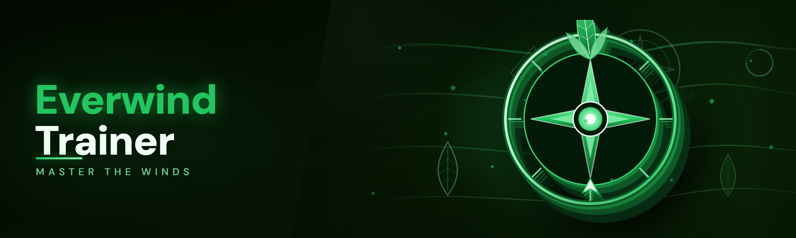

  
  
  

  

  
  
  
  

---

---

## 🧭 Table of Contents

- [⚡ Quick Start](#-quick-start)
- [🗡️ Key Features](#️-key-features)
- [🧰 Installation](#-installation)
- [🗺️ Roadmap / Planned Features](#️-roadmap--planned-features)
- [🫂 Community & Support](#-community--support)
- [⚙️ How It Works](#️-how-it-works)
- [🎯 The Solution](#-the-solution)
- [⌨️ Hotkeys / Controls](#️-hotkeys--controls)
- [🤖 AI Integration](#-ai-integration)
- [📜 Changelog / Release History](#-changelog--release-history)
- [⚖️ Comparison](#️-comparison)
- [💡 Tips for Best Results](#-tips-for-best-results)
- [🖥️ System Requirements](#️-system-requirements)
- [✅ Usage Guidelines](#-usage-guidelines)
- [❓ FAQ](#-faq)

---

## 🧭 Everwind Trainer — 2026 build, clean-slate rewrite

This is the 2026 build. If you ran the old trainer at any point in the last two years, the first thing you'll notice is that almost nothing is where it used to be — the memory layer got rebuilt from scratch after the latest platform patch, the overlay renderer swapped to a lighter pipeline, and the whole ESP stack now runs on a single pass instead of the three it used to churn through. The changelog below leads with that; everything else is downstream of it.

It started because every paid Everwind trainer I tried was either a $20/month subscription that broke on every patch, a repackaged version of a free script with a shiny UI, or a Discord-gated paywall where you paid before you saw whether the ESP even loaded on your rig. I built the free version, kept it free, and I patch it myself.

### 🖥️ System Requirements — read this before you download

| Component | Minimum | Recommended |
|---|---|---|
| OS | Windows 10 21H2 (64-bit) | Windows 11 23H2+ |
| CPU | Quad-core 2.8 GHz | 6-core 3.6 GHz+ |
| RAM | 8 GB | 16 GB |
| GPU | DirectX 11 capable | DirectX 12 capable |
| Game Mode | Windowed / Borderless | Borderless |
| Runtime | .NET Desktop Runtime 8 | .NET Desktop Runtime 8 (latest) |
| Privileges | Administrator | Administrator |
| Antivirus | Exclusions configured | Exclusions configured + Defender real-time off |

If you're on a laptop with hybrid graphics, set the .exe to run on the discrete GPU in Windows Graphics Settings first. The overlay will not render on the integrated adapter in most cases.

---

## ⚡ Quick Start

1. 🧲 **Grab the build** — visit the project page and download the current archive. The build has no fixed filename; whatever's in the archive is the one to run.
2. 📦 **Extract to a permanent folder** — not your Downloads folder, not `Desktop`, not a temp directory. Windows Defender will re-scan on every launch if you leave it in a scanned path.
3. 🛡️ **Add the folder to Defender exclusions** before first launch. See [Installation](#-installation) step 2 for the exact path.
4. 🎮 **Launch Everwind**, get into a match or the lobby — anywhere the game process is live.
5. 🖱️ **Run the .exe as Administrator**, wait for the green "Attached" indicator in the top-left of the overlay, then open the menu with `Insert`.
6. 🧠 Load a preset (or build your own) and toggle modules from the sidebar. Settings persist to `config.json` on exit.

### ⬇️ Download

  

---

## 🗡️ Key Features

The trainer ships as one `.exe` with an in-process overlay. No injector DLL to sideload, no driver to sign, no manual memory edits. Everything below runs off the same attach cycle.

| Feature | Description | Benefit |
|---|---|---|
| Player ESP | Box, skeleton, health bar, name, distance, weapon icon | Full situational picture at a glance |
| Skeleton ESP | Bone-accurate joint tracking with per-bone color | Reads poses and aim direction before a fight opens |
| Item ESP | Loot, chests, spawns, ammo, meds — filterable | Loot the worthwhile rooms, skip the noise |
| Extraction ESP | Extraction points + timer overlay | No missed windows, no wandering |
| Aimbot | FOV-limited, humanized smoothing, per-weapon profiles | Configurable, not a one-size toggle |
| Silent Aim | Server-side hit registration routing | Works within the same anti-cheat envelope as aimbot |
| Triggerbot | Hold-to-fire with per-weapon delay tuning | Cleaner than a raw autoclick in close range |
| Recoil Control | Per-weapon spray pattern compensation | Keeps bullet grouping tight on auto-fire |
| No Recoil / No Spread | Toggleable, independent of aimbot | Clean shots without touching aim behavior |
| Radar Hack | Minimap override with full lobby visibility | Situational awareness on the map screen |
| Speed Modifier | Slider-tuned walk/run multiplier | Traversal tuning without hard teleport |
| No Fall Damage | Toggle, applies on land | Positional freedom on vertical maps |
| Wallhack (Radar+ESP) | Through-geometry rendering flag | Combined with ESP for full visibility |
| Enemy Movement Prediction | Velocity-based aim leading | Hits moving targets more cleanly at range |
| Loot Filter | Per-rarity, per-category visibility | Cuts overlay clutter dramatically |
| Stream-Proof Mode | Overlay hidden from OBS/recording capture | Records while running without showing modules |
| Config Presets | Save/load named profiles | Swap between "legit" and "testing" instantly |
| Hotkey Rebinding | Every action rebindable in-menu | No fixed keybinds to memorize |
| Panic Key | Instant full module disable + process detach | One key ends everything cleanly |
| Log Viewer | In-overlay attach/memory event log | Debugs near-misses without external tools |

### 🗡️ **Combat Modules**

| Feature | Effect |
|---|---|
| Aimbot (FOV slider) | Rotates aim toward nearest valid target inside the FOV cone |
| Aimbot (Smoothing) | Humanizes the rotation speed, tunable from raw to glide |
| Aim Priority (Head/Chest/Nearest) | Controls which bone the aimbot locks to |
| Aim Delay | Adds a configurable millisecond delay before lock |
| Silent Aim | Routes hits server-side without visible camera movement |
| Triggerbot (Hold) | Fires on crosshair overlap while the key is held |
| Triggerbot (Delay) | Per-weapon fire-delay to avoid instant-fire signatures |
| Recoil Reduction | Per-weapon pattern compensation, independent of aim |
| No Spread | Removes bullet deviation from the aim path |

### 👁️ **Visual / ESP Modules**

| Feature | Effect |
|---|---|
| Player Box ESP | 2D box around each player, color by team/faction |
| Player Skeleton ESP | Full bone draw with joint highlight |
| Health Bar ESP | Bar overlay with numeric readout |
| Distance ESP | Live meters-to-target under each box |
| Weapon/Stance ESP | Current weapon name + stance icon |
| Item ESP (filtered) | Rarity + category filters for loot and chests |
| Extraction ESP | Extraction zone rings + timer text |
| Radar Override | Full-lobby minimap with directional facing |
| Chams (through-wall color) | Player models rendered with a solid color flag |

### 🧠 **Utility Modules**

| Feature | Effect |
|---|---|
| Speed Multiplier | Walk/run scalar, clamped to safe range |
| Jump Height Modifier | Tuned jump impulse multiplier |
| No Fall Damage | Ignores fall-damage hits |
| No Stamina Drain | Keeps sprint going without the bar ticking down |
| Instant Loot Interaction | Removes the loot-hold timer |
| Fast Reload | Skipped reload animation frame, tunable |
| Infinite Ammo (visual) | Ammo counter stays full; does not touch server-side inventory |
| Item Durability Guard | Keeps equipped gear from degrading during a run |

### 🛠️ **System / Config Modules**

| Feature | Effect |
|---|---|
| Stream-Proof Mode | Overlay excluded from OBS and recording capture |
| Panic Key | Full disable + process detach in one press |
| Config Save/Load | Named JSON profiles under `config/` |
| Hotkey Rebinding | Per-action keybind, saved to profile |
| Attach Log | Timestamped attach/memory/detach events |
| Elegant Unload | Removed hooks and drained memory on exit |
| Auto-Update Check | Notifies on new builds from the project page |
| Module Favorites | Pin frequently-used modules to the top of the sidebar |

---

## 🧰 Installation

1. **Get the archive.** Visit the project page, download the current build, extract it to a permanent folder (e.g. `C:\Tools\everwind-trainer\` — not `Downloads`). The folder name is up to you; the .exe inside is the one to run.
2. **Whitelist the folder.** Windows Security → Virus & threat protection → Manage settings → Exclusions → Add folder → point to the folder from step 1. This is mandatory; without it, Defender will quarantine the build on first run and you'll be back here wondering why nothing launched.
3. **Run the .exe as Administrator.** Right-click → Run as administrator. UAC will prompt; accept it. This is required for the memory attach step — the trainer will not attach to a game process running elevated without matching privileges.
4. **Attach, then configure.** With Everwind running (windowed or borderless preferred), press `Insert` to open the menu. Pick a preset or toggle what you need. Settings save on exit.

---

## 🗺️ Roadmap / Planned Features

| Feature | Status | ETA |
|---|---|---|
| Rewritten memory scanner (2026 patch) | ✅ Shipped | — |
| Silent aim routing rewrite | ✅ Shipped | — |
| Stream-proof overlay | ✅ Shipped | — |
| Extended loot filter presets | ✅ Shipped | — |
| Per-weapon aim profiles | ✅ Shipped | — |
| Bone-accurate skeleton ESP | ✅ Shipped | — |
| Extraction timer overlay | ✅ Shipped | — |
| Panic key polish | ✅ Shipped | — |
| Auto-config sync across profiles | 🧪 In development | Q2 2026 |
| Multi-monitor overlay support | 🧪 In development | Q2 2026 |
| Extended chams customization | 📋 Planned | Q2 2026 |
| Controller-friendly menu nav | 📋 Planned | Q3 2026 |
| Per-preset hotkey sets | 📋 Planned | Q3 2026 |
| Linux/Wine compatibility notes | 📋 Planned | Q3 2026 |
| Kernel-level driver (optional) | 🔍 Researching | Unscheduled |
| Module marketplace for community presets | 🔍 Researching | Unscheduled |

---

## 🫂 Community & Support

- **Issues** — open a GitHub issue for reproducible bugs; attach the attach-log excerpt from the overlay's log viewer.
- **Discussions** — feature requests and preset sharing live in Discussions, not Issues. Keep the two channels clean and the triage stays fast.
- **Preset sharing** — post your `config.json` in Discussions with a short description of what it's tuned for (close-quarters, sniping, loot runs, etc.).
- **Patch broken?** — if the trainer fails to attach after a game patch, that's expected within the first 24–72 hours of any major drop. Watch the Releases tab for a compat update; don't re-report it in every issue.
- **Responsible disclosure** — for anything security-adjacent (say, an unexpected write pattern), email rather than opening a public issue.

---

## ⚙️ How It Works

The trainer is a single portable `.exe` compiled against .NET 8 Desktop Runtime. On launch it spawns an overlay window drawn by a lightweight DirectX 11 swap chain layered above the game's window handle, and a separate worker thread that attaches to the game process via `ReadProcessMemory` / `WriteProcessMemory` (with `OpenProcess` requesting `PROCESS_VM_READ | PROCESS_VM_WRITE | PROCESS_QUERY_INFORMATION`). The memory layer maintains a small registry of static offsets plus pointer chains resolved per module — offsets are updated in each build after the game's patch cadence moves them, and the registry is seeded at attach from the current build manifest. Modules read their target values on a shared tick (default 60 Hz, tunable) and write only when a toggle is on and a value has actually changed, which keeps the write surface minimal and the attach log readable. The ESP renderer pulls from a per-frame snapshot of the entity list — a flat array rebuilt every tick — and draws from that snapshot so it never stalls on a mid-frame memory page fault. Config, hotkeys, and presets serialize to JSON under `config/` next to the .exe; the panic key does a hard teardown: every module writes its "off" value, hooks are removed, the handle is closed, the overlay exits. No scheduled tasks, no persistence, no auto-launch.

---

## 🎯 The Solution

| Problem | Solution |
|---|---|
| Paid trainers break on every patch and charge monthly | Free, MIT-licensed, patched by the maintainer within 24–72h of a game update |
| Paywalled Discord gates before you can even verify the ESP loads | Public project page, no gate, no account, no payment |
| Repackaged scripts with a shiny UI and no source | Single .exe, no sideloaded DLLs, transparent build manifest |
| Overlay bleeds into recordings and streams | Stream-proof mode excludes overlay from OBS/recording capture |
| Configs reset on every launch | All settings persist to JSON profiles under `config/` |
| Panic situations require alt-tabbing and killing the process | Panic key does a clean full disable + detach in one press |
| No visibility into what the trainer is doing | In-overlay log viewer exposes every attach, write, and detach event |

---

## ⌨️ Hotkeys / Controls

| Key | Action | Notes |
|---|---|---|
| `Insert` | Open / close the menu | Default; rebindable |
| `Delete` | Panic — full disable + detach | Hard teardown, not a toggle |
| `F1` | Toggle ESP master | Cascades to all ESP sub-modules |
| `F2` | Toggle aimbot master | Cascades to aim sub-modules |
| `F3` | Toggle triggerbot | Independent of aimbot |
| `F4` | Toggle radar override | Applies next render tick |
| `F5` | Cycle preset | Loads next named profile |
| `F6` | Toggle stream-proof mode | Overlay hides from capture |
| `Home` | Reload config from disk | Useful after hand-editing |
| `End` | Save current config to disk | Also runs on clean exit |
| `Mouse5` (hold) | Aim assist hold key | Default; rebindable per profile |
| `X` (hold) | Triggerbot hold key | Default; rebindable per profile |

---

## 🤖 AI Integration

The 2026 build ships two AI-adjacent features that stay entirely local — no cloud calls, no telemetry, nothing leaves the machine:

- **Adaptive Aim Smoothing** — a small on-device model watches your pointer velocity and per-weapon touch-time over the session, then nudges the smoothing curve toward whatever you actually settle into. It's a personalization layer, not a replacement for the slider: you can lock the curve manually at any time.
- **Loot Priority Scoring** — the loot filter learns which categories you actually pick up (by tracking the hold-to-loot events you trigger) and re-ranks the ESP item tiers over a session. You can reset the score from the menu any time; it lives in `config/loot_scores.json`.

Both run on CPU, both are toggleable, neither requires an account or a network connection. If you don't want them, nothing about the core modules changes.

---

## 📜 Changelog / Release History

| Version | Date | Changes |
|---|---|---|
| 2026.03 | 2026-03-14 | Memory scanner rebuilt for latest platform patch; silent aim routing rewritten; overlay renderer swapped to single-pass DX11; panic key now closes handle before overlay exit |
| 2026.02 | 2026-02-20 | Stream-proof mode added; per-weapon aim profiles; skeleton ESP bone-accurate; loot filter rarity tiers |
| 2026.01 | 2026-01-09 | Extraction timer overlay; chams customization; distance ESP readout precision fix |
| 2025.12 | 2025-12-15 | Speed modifier slider clamp; jump modifier; no-stamina toggle; log viewer panel |
| 2025.11 | 2025-11-08 | Config presets save/load; hotkey rebinding for all actions; auto-update notify |
| 2025.10 | 2025-10-22 | Initial 2026-line attach cycle; ESP master toggle; radar override |

---

## ⚖️ Comparison

| Aspect | Typical paid trainer | This trainer |
|---|---|---|
| Price | $15–25/month subscription | Free, MIT |
| Patch turnaround | "Best effort," often 1–2 weeks | 24–72h after a game patch |
| Distribution | Discord invite gate | Public project page |
| Source visibility | Closed, obfuscated | Build manifest + changelog visible |
| Config persistence | Often resets per launch | JSON profiles under `config/` |
| Panic handling | Alt-tab + kill process | Panic key, clean detach |
| Stream safety | Manual OBS config | Stream-proof toggle built in |
| Feature scope | "Everything" (unverifiable) | Documented module list, versioned |

---

## 💡 Tips for Best Results

- **Run the game in borderless windowed** — fullscreen exclusive occasionally causes the overlay to lag behind the render loop on high-refresh displays.
- **Set a Defender exclusion on the folder** before first launch. Doing it after the fact means the .exe is already gone.
- **Match your run-as-Administrator to the game's privilege level.** If the game is launched as admin (some launchers do this), the trainer must be too.
- **Don't stack trainers.** Running two memory-readers on the same process is the fastest way to get a hard crash and a corrupted config.
- **Tune the tick rate down** (menu → Settings → tick Hz) if you're on a low-core CPU and see frame drops in heavy fights.
- **Use presets.** Building a "legit" and a "testing" profile and swapping with `F5` is faster than re-toggling modules every session.
- **Watch the attach log** if a module misbehaves — the log timestamps every write and will tell you if a pointer chain resolved stale.
- **Back up `config/`** before a major game patch. If offsets break, your presets are still intact.

---

## 🖥️ System Requirements

| Component | Minimum | Recommended |
|---|---|---|
| OS | Windows 10 21H2 (64-bit) | Windows 11 23H2+ |
| CPU | Quad-core 2.8 GHz | 6-core 3.6 GHz+ |
| RAM | 8 GB | 16 GB |
| GPU | DirectX 11 capable | DirectX 12 capable |
| Disk | 200 MB free | 500 MB free |
| Runtime | .NET Desktop Runtime 8 | .NET Desktop Runtime 8 (latest) |
| Privileges | Administrator | Administrator |
| Antivirus | Exclusions configured | Exclusions configured + Defender real-time off |
| Game Mode | Windowed / Borderless | Borderless |

---

## ✅ Usage Guidelines

| Allowed | Not allowed |
|---|---|
| Personal single-player and private-session use | Using the trainer in ranked / competitive public lobbies where it affects other players' outcomes |
| Using it on a local test server or offline match | Reselling the build or bundling it into a paid product |
| Sharing presets via Discussions | Distributing repacked builds from third-party links |
| Modifying the source and contributing patches | Claiming the trainer is "undetectable" or guaranteed safe — nothing is, and I won't say otherwise |
| Recording and streaming with stream-proof mode on | Using it to grief, harass, or dox other players |
| Educational reading of the source and build manifest | Re-uploading it to a paid cheat marketplace |

**Use at your own risk.** Every account-level consequence is on the user — I patch the tool, not the platform's enforcement policy. This is a hobbyist / educational project for people who want to read the source and understand how a memory-layer trainer actually works, and for those who want a free alternative to the subscription trainers. If your use case requires you to pretend otherwise, this isn't the project for you.

---

## 🐞 Known Issues

| Issue | Solution |
|---|---|
| Trainer won't attach — "process not found" | Launch the game first, then the trainer. If the game is elevated and the trainer isn't, UAC mismatch will silently block the attach — run both as admin |
| Overlay invisible in OBS | Enable stream-proof mode (`F6`); the overlay is excluded from capture by design, not by accident |
| ESP boxes misalign after a game patch | Offsets moved; wait for the compat build on the Releases tab, or run the offset manifest update if you're building from source |
| High-refresh monitors show overlay tearing | Switch game to borderless; the DX11 swap chain doesn't fully sync on exclusive fullscreen above 144 Hz on some GPU drivers |
| Triggerbot fires on teammates in co-op maps | Team filter isn't fully wired for the co-op layer yet; toggle team-check off and manually scope the FOV down |
| Panic key doesn't fully detach | Close the game first, then panic — the handle close can block on an in-flight write during an active match |
| Config resets after a crash | Back up `config/` periodically; crashes skip the on-exit save path |

---

## ❓ FAQ

<b>Is this really free?</b>

Yes. MIT-licensed, no subscription, no paywall, no account. Donations are welcome but nothing is gated behind them.

<b>Will I get banned?</b>

Any memory-layer trainer carries detection risk. I can't promise otherwise and I won't. Use it in private sessions and offline matches if that matters to you.

<b>Does it work on the current game patch?</b>

The current build targets the latest patch as of the changelog date. If the game patched after that, wait for the compat release — usually 24–72 hours.

<b>Do I need to install anything else?</b>

Only the .NET Desktop Runtime 8. No pip, no npm, no git — download, extract, run the .exe.

<b>Why does Defender flag the .exe?</b>

Memory-reading tools trigger heuristic signatures by nature. Add the folder to exclusions before first launch. If you're not comfortable with that, don't run it.

<b>Can I run it without Administrator?</b>

Not reliably. The attach step needs matching privileges with the game process. If the game isn't elevated, the trainer sometimes works without admin — but the default recommendation is run both as admin.

<b>Can I rebind the panic key?</b>

Yes. Menu → Settings → Hotkeys, rebind any action, saved to the active profile.

<b>Does stream-proof mode actually work?</b>

It excludes the overlay's swap chain from capture APIs used by OBS and common recorders. It's not a guarantee against every capture method, but it covers the mainstream ones.

<b>Will you add more modules?</b>

The Roadmap table above is the honest list. Shipped items get moved; unscheduled items are honestly unscheduled. No fake ETAs.

<b>Can I contribute?</b>

Yes — PRs and issues welcome. Open a Discussion first for anything non-trivial so we don't collide on the offset manifest.

---

### ⬇️ Download

  

---

The 2026 build exists because the paid options kept breaking and kept asking for money. The changelog leads with the memory scanner rewrite because that's what actually mattered this cycle — everything else is downstream. If you've been waiting for a version that survives the latest patch and still costs nothing, this is it. Patch reports and preset shares go in Discussions; the attach log is the first thing I'll ask for.
